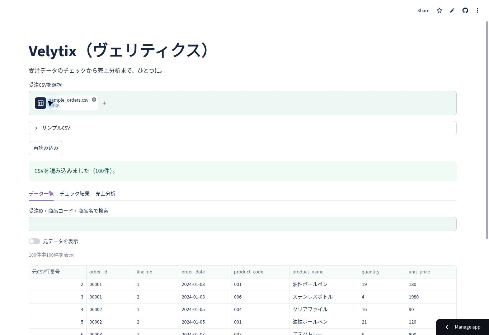
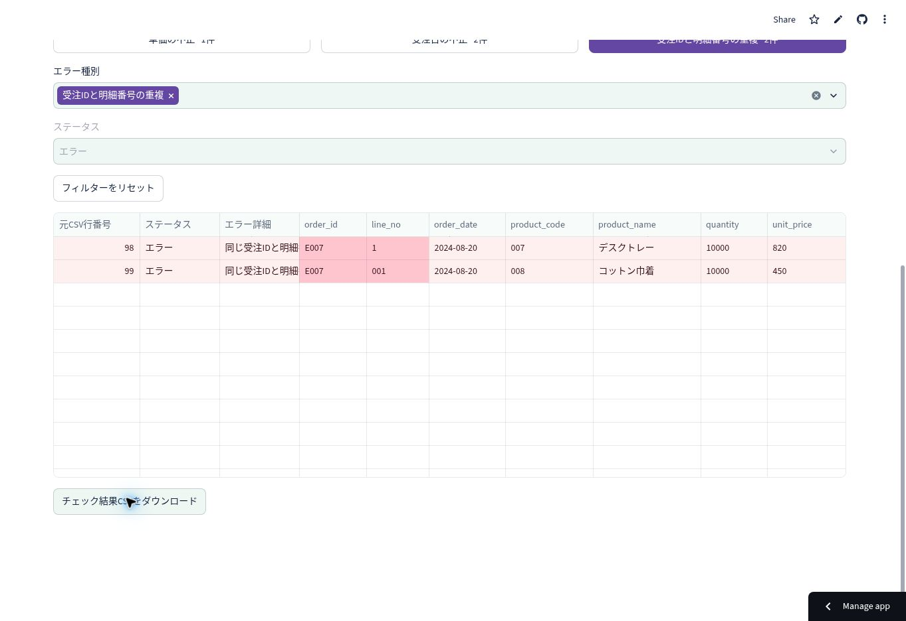
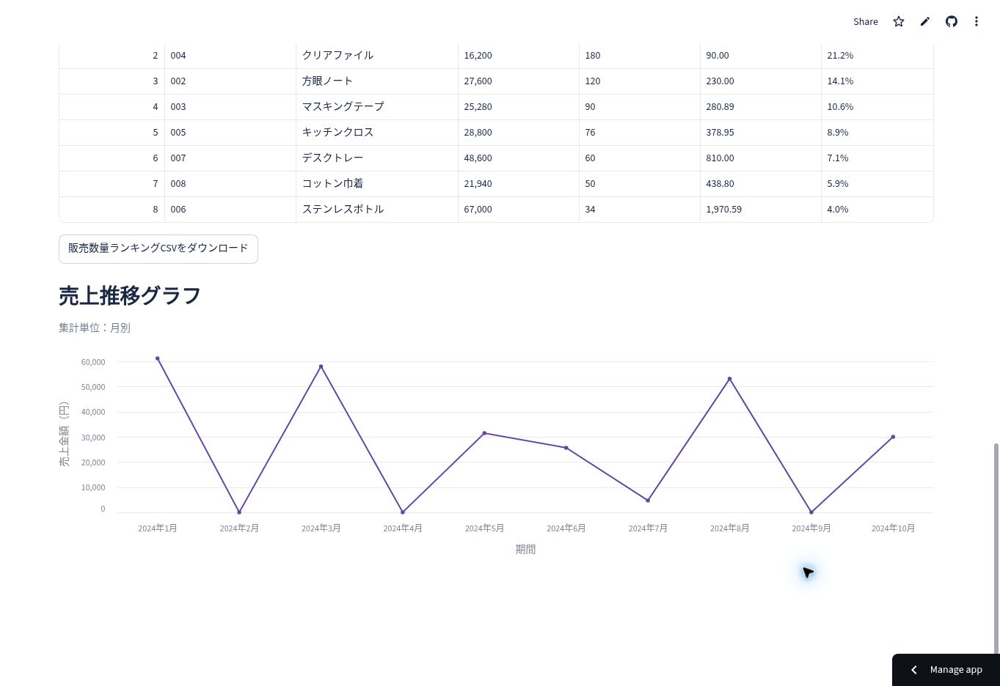

# Velytix（ヴェリティクス）

**受注データのチェックから売上分析まで、ひとつに。**

Velytixは、受注CSVの入力ミスや重複を見つけ、正常な明細から売上と販売数量を集計する日本語のWebアプリです。CSVの読み込み、検証、集計、画面表示、出力を実装したPythonの就職活動用ポートフォリオです。名前は Verify（検証）と Analytics（分析）から着想を得ています。

## 公開デモ

[Velytixを開く](https://velytix.streamlit.app/)

### データ一覧



### チェック結果



### 売上分析



## 主な機能と使い方

1. **CSVを読み込む。** 「受注CSVを選択」からファイルを指定します。内容を確認し直すときは「再読み込み」を押します。
2. **明細を確認する。** 「データ一覧」で元CSVの行番号と明細を確認します。受注ID・商品コード・商品名で検索でき、正規化後の値と元の値を切り替えられます。
3. **入力エラーを確認する。** 「チェック結果」では正常・エラー件数と日本語のエラー詳細を確認できます。ステータスや複数のエラー種別で絞り込めます。チェック結果CSVには絞り込みに関係なく全明細が入ります。
4. **売上を分析する。** 「売上分析」で開始日と終了日を指定します。正常明細の受注件数、売上金額、販売数量、商品別ランキングと推移を確認できます。期間に応じて推移を日別・週別・月別に切り替え、売上のない区間は0円で表示します。月別ラベルは「2024年1月」形式で、横幅が狭いときは重なるラベルを間引きます。
5. **結果を保存する。** 売上金額・販売数量のランキングは別々のCSVとして保存できます。ランキングCSVには選択した日付範囲と上位件数が反映されます。構成比は画面では小数第1位までの百分率、CSVでは追加の丸めをかけない小数値です。

## 使用技術

動作確認環境は Python 3.12.14、Streamlit 1.67.0、pandas 2.3.3、Altair 6.3.0、pytest 8.4.2 です。画面操作の自動テストには Streamlit AppTest を使います。

## CSV入力仕様

ヘッダーには次の7列が必要です。列順は自由で、列名の大文字・小文字は区別します。追加列も使用できます。ヘッダー名の重複は読み込みエラーになります。

| 列名 | 内容とルール |
|---|---|
| `order_id` | 受注ID。文字列として扱い、先頭のゼロを保持 |
| `line_no` | 明細番号。半角数字のみ、1〜999999 |
| `order_date` | 受注日。YYYY-MM-DD形式で、2000-01-01〜2099-12-31の実在する日付 |
| `product_code` | 商品コード。文字列として扱い、先頭のゼロを保持 |
| `product_name` | 商品名。空欄はエラー |
| `quantity` | 数量。半角数字のみ、1〜999999 |
| `unit_price` | 単価。半角数字のみ、0〜999999999 |

- ファイルの上限は10MB（10,000,000バイト）。UTF-8（BOMあり・なし）を優先し、デコードできなければCP932を試します。
- 区切り文字はカンマです。引用符で囲まれたフィールド内のカンマと改行に対応します。完全な空行は読み飛ばしますが、物理行番号に反映します。
- 明細が0件、列数が不一致、引用符が不正などの場合はファイル全体の読み込みエラーになります。
- 各フィールドの前後の半角・全角スペースを取り除いて検証します。内部の空白と元の値を保持します。
- 整数欄で `005` は有効です。小数、負数、全角数字、カンマ区切り、指数表記は入力エラーです。

### 検出する6種類のエラー

1. 必須項目の未入力
2. 明細番号の不正
3. 数量の不正
4. 単価の不正
5. 受注日の不正
6. 受注IDと明細番号の重複

1行に複数のエラーが付くことがあります。受注IDと有効な明細番号の組み合わせが重複すると、その組み合わせの最初の行を含む全行がエラーになります。エラーのある明細は売上分析の対象から外れます。

## サンプルCSV

アプリ上部の「サンプルCSV」を開いてダウンロードするか、プロジェクトフォルダー内の同名ファイルを使います。CSVを「受注CSVを選択」から読み込んでください。

| ファイル | 確認できること |
|---|---|
| [sample_orders_clean.csv](sample_orders_clean.csv) | 正常100明細、50受注。複数明細を持つ受注、商品ごとの売上差、売上が0円の日・週・月 |
| [sample_orders.csv](sample_orders.csv) | 正常90明細、エラー10明細。6種類のエラー、1明細の複数エラー、正常明細だけを対象とする売上分析 |

どちらも架空の文房具・日用品データで、UTF-8 BOM付きです。「売上分析」で正常サンプルの期間を2024-01-03〜2024-01-09にすると日別、2024-01-03〜2024-03-15にすると週別、初期の全期間では月別の推移を確認できます。

再生成する場合は、下記のローカル環境を作ったあと、プロジェクトのルートで次を実行します。同じ内容のCSVをプロジェクトフォルダーに書き出します。

```powershell
.\.venv\Scripts\python.exe generate_sample_data.py
```

## ローカル実行（Windows 11・PyCharm）

1. Python 3.12を用意します。ZIPを使う場合は先に展開します。
2. PyCharmの **File → Open** から、`app.py` と `requirements.txt` がある `velytix` フォルダーを開きます。
3. PyCharm下部の **Terminal** を開きます。PowerShellで `Get-ChildItem` を実行すると、現在のフォルダーに `app.py` があるか確認できます。
4. 次を上から1行ずつ実行します。最初のコマンドでPython 3.12が表示されることを確認してください。

```powershell
py -3.12 --version
py -3.12 -m venv .venv
.\.venv\Scripts\python.exe -m pip install -r requirements.txt
.\.venv\Scripts\python.exe -m streamlit run app.py
```

PowerShellで仮想環境の有効化を行わずに実行できるよう、仮想環境のPythonを直接指定しています。ターミナルに表示される **Local URL** をブラウザで開きます。停止するときはターミナルで **Ctrl+C** を押します。

PyCharmのエディターでも同じ環境を使う場合は、設定の **Python Interpreter** で既存のインタープリターを追加し、プロジェクト内の `.venv\Scripts\python.exe` を選びます。メニュー名はPyCharmのバージョンによって異なります。[PyCharmのプロジェクトを開く手順](https://www.jetbrains.com/help/pycharm/open-projects.html)

### テストを実行する

プロジェクトのルートで実行します。アプリが起動中なら、別のターミナルを開いて実行できます。

```powershell
.\.venv\Scripts\python.exe -m pytest -q
```

## プロジェクト構成

| パス | 役割 |
|---|---|
| `app.py` | Streamlit画面とセッション状態 |
| `csv_loader.py` | CSV読み込み、構造チェック、物理行番号の取得 |
| `validator.py` | 正規化、入力値の検証、エラー分類 |
| `analyzer.py` | 正常明細の売上集計、ランキング、推移 |
| `exporter.py` | チェック結果・ランキングのCSV出力 |
| `generate_sample_data.py` | サンプルCSVの再生成 |
| `sample_orders_clean.csv`、`sample_orders.csv` | 動作確認用の架空の受注データ |
| `tests/` | 単体テストとAppTest |
| `.streamlit/config.toml` | ライト・ダークテーマの設定 |
| `requirements.txt` | 依存パッケージのバージョン指定 |

## CSV出力時の数式インジェクション対策

チェック結果とランキングはUTF-8 BOM付きで出力します。CSV出力時に、`=`、`+`、`-`、`@` や全角の同等記号から始まる文字列を検査します。先頭の空白・制御文字で記号が隠れている場合も検出し、該当する文字列には先頭にアポストロフィを付けます。対象には元CSV由来の追加列名も含まれます。アプリ内の元データは保持し、正常な数値は数値として扱える形式で出力します。

表計算ソフトでCSVを再保存すると、ソフトによっては対策用の文字が除かれることがあります。[OWASPのCSV Injection解説](https://community.owasp.org/attacks/CSV_Injection)

### Excelで先頭のゼロを保持して取り込む

1. Excelの **データ → テキストまたはCSVから** でファイルを指定します。
2. プレビューで文字コードがUTF-8、区切り文字がカンマであることを確認し、**データの変換** を押します。
3. Power Queryで、必要に応じて自動追加された「変更された型」ステップを削除します。`order_id`、`product_code`、対応する `raw_` 列、ランキングの「商品コード」など、元の表記を保持したい列のデータ型を **テキスト** にします。
4. プレビューで `001` のような値を確認してから、**閉じて読み込む** を選びます。[Microsoftの先頭ゼロを保持する手順](https://support.microsoft.com/en-us/excel/keeping-leading-zeros-and-large-numbers)

## 既知の制限事項

- アップロードしたデータはセッション内で扱います。データベースへの保存は行いません。
- チェック結果の表示セル数がpandasの着色上限を超えた場合は、ステータスと日本語のエラー詳細で確認できます。

## 今後の改善候補

- 大きなCSVを使った画面描画と検索の速度測定
- ブラウザでのアップロードからCSV保存までの自動テスト
